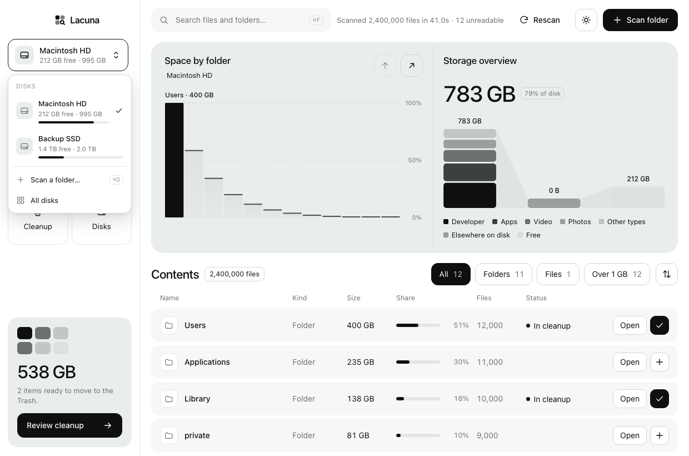

<div align="center">


# Lacuna

**See what fills your disk. Clear it in a few clicks.**

A fast, native disk space analyzer for macOS, built with Rust and Tauri.


<br />




https://github.com/user-attachments/assets/20a685ae-25af-4c58-ac7e-b9baf2ba31dc


</div>

<br />

## Why Lacuna

- **Fast.** Reads a whole folder per system call (`getattrlistbulk`) across 16 threads. In testing it scanned 6.2 million files in 32 seconds.
- **Exact.** Totals match `du` to the kilobyte. Hard links are counted once, symlinks aren't followed, and other volumes aren't entered.
- **Safe.** Nothing is deleted outright. Files go to the Trash, and you see the exact paths and total before you confirm.
- **Honest.** Suggestions say *why* something is safe to remove, duplicates are matched byte for byte, and space it can't see is explained, not hidden.
- **Private.** No network access, no accounts and no telemetry. Your file list never leaves your Mac.
- **Small.** A 7 MB download with a native window, light and dark themes, and a custom title bar.

## Features

| | |
|---|---|
| **Disks** | Every mounted disk with free space. Scan one, pick a folder (<kbd>⌘</kbd><kbd>O</kbd>), or drop a folder on the window. |
| **Overview** | *Space by folder* bar chart and a *storage overview* (this folder by file type, everything else, free space). Click a bar to drill in. |
| **Map** | Switch *Space by folder* to a treemap, two levels deep. Click a folder to drill in, a file to preview it. |
| **Suggestions** | Data Lacuna recognises as regenerable: Xcode DerivedData and device support, simulator caches, Homebrew, npm/Yarn/pip/Cargo/Gradle caches, Rust `target` and JS build caches in your projects, `node_modules`, Docker's disk image, local AI models, iPhone backups, old macOS installers and more. Each says why it's safe, marks it **Safe** or **Review**, and names the tool's own cleanup command where there is one. |
| **Large files** | The 200 biggest files under the current folder, or the biggest files and folders **untouched** for a year or two (not changed or opened, going by modified, accessed and Finder's "last opened" dates). |
| **Duplicates** | Files with exactly the same content, 1 MB and up. Hard links and APFS clones share storage, so they count once and never inflate the total. |
| **Changes** | Each full scan is summarised on your Mac, so the next scan shows what grew or shrank, down to the most specific folder or file. The Overview table gains a *Change* column. |
| **Hidden space** | Why *used* is more than the files found: the macOS system volume, swap, Preboot and Recovery, local snapshots, folders it couldn't read, and how much macOS calls purgeable. |
| **File types** | Space by category: Apps, Developer, Video, Photos, Audio, Documents, Archives & disk images. `node_modules`, `.git`, `target` and friends count as Developer. |
| **Search** | Find any file or folder by name across the whole scan, largest first (<kbd>⌘</kbd><kbd>F</kbd>). |
| **Cleanup** | Press <kbd>+</kbd> on any row, or drag rows onto the Cleanup card, then review and move them to the Trash. Views update without a rescan. |
| **Export** | Save the current folder to CSV: every item of 1 MB or more, with size, file count and last-used date. |
| **Menu bar** | Free space on the startup disk at a glance, a notification when it runs low, and an option to keep Lacuna in the menu bar when the window is closed. |

### Keyboard shortcuts

| Shortcut | Action |
|---|---|
| <kbd>⌘</kbd><kbd>O</kbd> | Scan a folder |
| <kbd>⌘</kbd><kbd>F</kbd> | Search |
| <kbd>⌘</kbd><kbd>R</kbd> | Rescan |
| <kbd>⌘</kbd><kbd>↑</kbd> | Up one folder |
| <kbd>Space</kbd> | Quick Look the item under the pointer |
| <kbd>Esc</kbd> | Clear search / close menus |

## Download

Get the latest version from **[lacuna.nakel.app/download](https://lacuna.nakel.app/download/)**, or from
[GitHub Releases](https://github.com/nakel-ola/lacuna/releases/latest). It's one app for Apple silicon and Intel Macs.

1. Open `Lacuna.dmg` and drag Lacuna to **Applications**.
2. Open it from Applications. Lacuna is signed and notarized by Apple, so it opens like any other app.

## Building from source

**You'll need:** macOS 10.15 or later, [Rust](https://rustup.rs) (stable), [Node.js](https://nodejs.org) 22+ and [pnpm](https://pnpm.io) 10+.

```bash
git clone <this-repo> lacuna
cd lacuna
pnpm install

pnpm dev      # run the app with hot reload
pnpm build    # → apps/desktop/src-tauri/target/release/bundle/macos/Lacuna.app
pnpm test     # Rust unit tests
```

### Command line

The app doubles as a command-line tool. Link it onto your `PATH` once:

```bash
ln -s /Applications/Lacuna.app/Contents/MacOS/lacuna /usr/local/bin/lacuna
```

```bash
lacuna scan ~                    # biggest folders and files, in the terminal
lacuna scan ~/Projects --json    # the same as JSON
lacuna scan / --csv sizes.csv    # every item of 1 MB or more, to a CSV file
```

The command line only reads; it never deletes anything.

### Full Disk Access

macOS protects some folders (Mail, Safari, other apps' data). Without **Full Disk Access** they show up as "No permission" and their size can't be counted. Lacuna shows a banner with a shortcut to the setting:

> System Settings → Privacy & Security → Full Disk Access → enable **Lacuna**

On the startup disk Lacuna scans `/System/Volumes/Data`. Since macOS 10.15, `/` is a sealed, read-only system volume, and everything you can change lives on the Data volume.

## How it works

```
┌──────────────────────────── Lacuna.app ────────────────────────────┐
│                                                                    │
│   React + TypeScript UI            Rust core (Tauri commands)      │
│   ─────────────────────            ──────────────────────────      │
│   charts, tables, cleanup   ◀──▶   scanner  · 16 threads,          │
│   zustand store                       getattrlistbulk, arena tree  │
│                                    view     · depth-limited slices │
│        ▲  scan-progress /          insights · large files, types,  │
│        └─ scan-done events                    search               │
│                                    volumes  · statfs               │
│                                    trash    · NSFileManager        │
└────────────────────────────────────────────────────────────────────┘
```

| Piece | Where | What it does |
|---|---|---|
| Bulk directory reads | [`bulk.rs`](apps/desktop/src-tauri/src/bulk.rs) | `getattrlistbulk(2)` returns names, types, inode and allocated size for a whole folder in one call. |
| Parallel scanner | [`scanner.rs`](apps/desktop/src-tauri/src/scanner.rs) | 16 workers drain a shared folder queue into an arena tree (`Vec<Node>` with `u32` ids). Sizes roll up to every ancestor as they're found, so the UI can draw a partial tree while scanning. |
| Views | [`view.rs`](apps/desktop/src-tauri/src/view.rs) | Sends the UI one folder at a time, folding items under 0.2% into "N smaller objects". |
| Insights | [`insights.rs`](apps/desktop/src-tauri/src/insights.rs) | Largest files (min-heap), untouched items, file-type breakdown and name search. |
| Suggestions | [`rules.rs`](apps/desktop/src-tauri/src/rules.rs) | The table of known regenerable data, each with a reason, a risk level and an optional command. |
| Duplicates | [`dupes.rs`](apps/desktop/src-tauri/src/dupes.rs) | Narrows by size, length and storage identity (clone id or inode), then 16 KB samples, then a BLAKE3 hash of the whole file, on several threads. |
| History | [`history.rs`](apps/desktop/src-tauri/src/history.rs) | Saves folders of 8 MB+ and files of 64 MB+ after each full scan (in `~/Library/Application Support/dev.lacuna.desktop/history`, last 12 per folder) and finds the most specific changes. |
| Hidden space | [`space.rs`](apps/desktop/src-tauri/src/space.rs) | Per-volume usage and snapshots from `diskutil apfs`, purgeable space from Foundation. No administrator password needed. |
| Menu bar | [`monitor.rs`](apps/desktop/src-tauri/src/monitor.rs) | Free-space item, low-space notification and the keep-running setting. |
| CLI and CSV | [`cli.rs`](apps/desktop/src-tauri/src/cli.rs), [`export.rs`](apps/desktop/src-tauri/src/export.rs) | `lacuna scan` and the CSV writer shared with the app. |
| Disks | [`volumes.rs`](apps/desktop/src-tauri/src/volumes.rs) | Mounted volumes and free space via `statfs`. |
| Commands | [`lib.rs`](apps/desktop/src-tauri/src/lib.rs) | Scan lifecycle, tree queries, Reveal in Finder, and Trash. Every deletion is re-checked on the Rust side: it must belong to the current scan, can't be the scanned folder itself, and items inside an already selected folder are dropped. |
| UI | [`apps/desktop/src`](apps/desktop/src) | React components, a zustand store, and typed wrappers for every command in [`api.ts`](apps/desktop/src/lib/api.ts). |

## Project structure

```
.
├── apps/
│   ├── desktop/              # the Lacuna app
│   │   ├── src/              # React + TypeScript UI
│   │   ├── src-tauri/        # Rust core and Tauri config
│   │   └── app-icon.svg      # icon source (pnpm --filter @lacuna/desktop icon)
│   └── web/                  # landing page (Vite + React, prerendered to static HTML)
├── docs/                     # design notes and images
├── turbo.json                # Turborepo tasks: dev, build, test, typecheck
└── pnpm-workspace.yaml
```

It's a [Turborepo](https://turborepo.com) monorepo. Run one app at a time with a filter:

```bash
pnpm --filter @lacuna/desktop dev   # the app
pnpm --filter @lacuna/web dev       # the landing page at http://localhost:4321
```

The landing page is static HTML. Set the production domain and repository URL in
[`apps/web/src/site.ts`](apps/web/src/site.ts) before deploying.

## Roadmap

- [x] Universal DMG releases built by GitHub Actions
- [x] Developer ID signing and notarization
- [ ] Privileged helper to scan folders even Full Disk Access can't read
- [x] APFS snapshots and purgeable space
- [x] Quick Look previews
- [x] Suggestions, duplicates, untouched files, scan history, treemap, CSV export, CLI and menu bar
- [ ] Homebrew cask
- [ ] Windows and Linux (the scanner already falls back to `std::fs` off macOS)

## Releasing

Bump `version` in `apps/desktop/src-tauri/tauri.conf.json` (and `Cargo.toml`), commit, then push a matching tag:

```bash
git tag v0.3.0 && git push origin v0.3.0
```

[`.github/workflows/release.yml`](.github/workflows/release.yml) builds a universal `Lacuna.app` and DMG and publishes the
release. It also attaches a copy named `Lacuna.dmg`, which the website's download page always points to. Builds are
signed with a Developer ID and notarized using the repository secrets listed at the top of the workflow
([`scripts/setup-signing.sh`](scripts/setup-signing.sh) sets them). Without those secrets they're ad-hoc signed.

## Contributing

Issues and pull requests are welcome. Before opening a PR:

```bash
pnpm typecheck
pnpm test
```

Keep changes focused, and match the style of the code around them.

## License

[MIT](LICENSE) © 2026 Nakel
